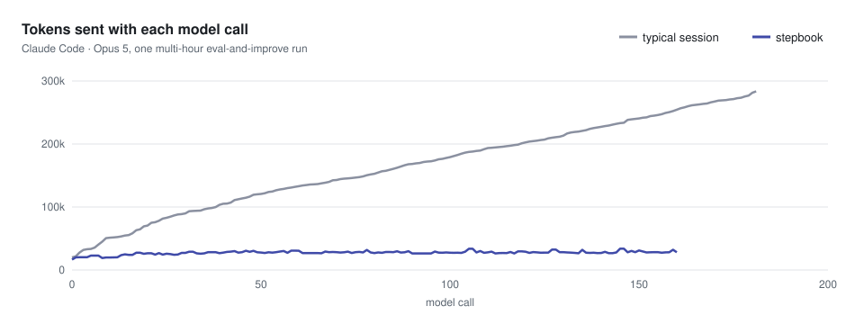
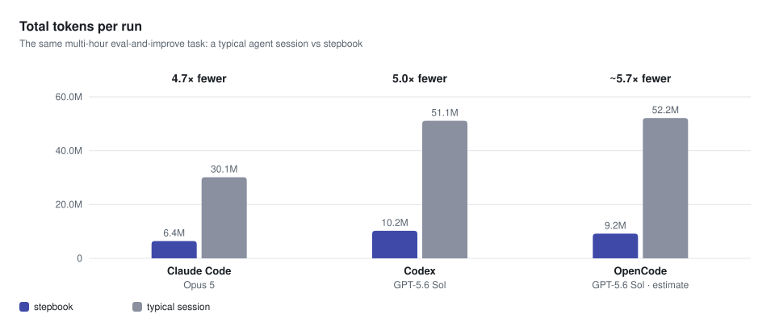

<p align="center"><picture><source media="(prefers-color-scheme: dark)" srcset="docs/assets/logo-dark.svg"></picture></p>

stepbook runs a long agent task as a series of short steps. Each step is a fresh agent session that reads a small
saved state instead of the whole conversation so far. A task can run for hours, and you can pause it, send it notes,
resume it later or hand it to another agent. It works with Claude Code, Codex and OpenCode, on the login you already
have.

## When to use it

Use it for work that takes an agent dozens to hundreds of steps and ends in something you can check:

- a command that must pass, such as a test suite after a framework upgrade or a migration that must keep each service
  green;
- a long list where each item has a done condition, such as call sites to migrate, docs pages to update or eval
  failures to triage;
- a number your scripts measure, such as eval accuracy, latency or cost per case.

It is a poor fit for open-ended work with nothing to check ("clean up this module") and for a short task you are
watching; a normal agent chat is simpler for both. To make a vague task fit, add a check first (tests, a lint or type
check that must pass) or write the concrete changes down as a list.

## Which skill to use

| Your task | Skill | Who judges the result | Setup |
|---|---|---|---|
| Work through a long checklist (200 call sites, 40 services, every docs page) until your commands pass | `checklist` | Your check commands: done means they all exit 0 | None |
| Improve a number that your eval scripts measure | `eval-loop` | The agent, from the eval results it runs | None |
| Improve a number, with computed comparisons and a hard cap on eval runs | `eval-loop-adapter` | The agent, next to a verdict stepbook computes | A small adapter script (`docs/adapter.md`) |
| You already have your own `SKILL.md` | Your skill, converted once | Your skill's checks | One command |

Each step's action in `checklist`, `eval-loop` and your own skills is one shell command in your project, so the agent
can read, edit and test anything a developer could.

## How it works

<picture></picture>

For every step, stepbook starts your agent CLI fresh (`claude -p`, `codex exec`, `opencode run`), gives it the skill,
the state and the latest result, takes back one state update and one action, and the session ends. Only `state.json`
and the journal carry over from one step to the next. So the prompt's size depends on the state, not on how many
steps came before, and any agent that can read the run folder can pick the run up. The loop follows the SKILL.state
paper (see Credits); stepbook adds the journal, git commits, your notes and resuming with another agent.

During a step the agent can read the project but changes nothing itself. It answers with three fields: `reasoning`,
which goes into the journal; `state_patch`, the only way to change the state, applied after stepbook validates it
against the skill's schema and protected fields; and `action`, which stepbook runs next. Every change to your files
comes from an action that stepbook runs, records and commits.

<picture></picture>

## Install

You need macOS or Linux, Git, uv (https://docs.astral.sh/uv/), and an agent CLI you are logged in to.

**Ask your agent.** Paste this into Claude Code, Codex, OpenCode or another coding agent:

```prompt
Install stepbook by following https://raw.githubusercontent.com/bahdan111/stepbook/main/docs/install-for-agents.md, then tell me how to start my first task.
```

**Claude Code plugin.** In Claude Code (these are slash commands, not shell commands):

```text
/plugin marketplace add bahdan111/stepbook
/plugin install stepbook@stepbook-plugins
```

**Codex plugin.** From a shell, then start a Codex session and ask with `$stepbook`:

```sh
codex plugin marketplace add bahdan111/stepbook
codex plugin add stepbook@stepbook-plugins
```

**The CLI**, for the terminal, other agents and scripts:

```sh
uv tool install stepbook
```

The plugins call `stepbook` when it is installed this way, and otherwise run it through `uvx`. stepbook uses your
agent's subscription login: it refuses to start if the agent CLI would bill an API key, unless you pass
`--allow-api-billing`.

## Your first task

1. Commit your own changes. New runs refuse a repository with uncommitted changes.
2. Describe the task to your agent: in Claude Code, "Use stepbook to make this project's tests pass. Show me the
   plan first."; in Codex, start the message with `$stepbook`. Say which command must pass (for example `pytest -q`),
   what the agent must not change, and roughly how many steps to allow.
3. Read the plan. The agent inspects the project, picks a skill and drafts the plan: the checklist or ideas, what
   it already found, how done is checked, the limits and where it will run. Ask for edits where needed.
4. Say go. The agent saves the plan, launches the run in the background and tells you how to follow it.

A run executes real commands as you, so it belongs in a container or in a separate Git worktree, which the agent
creates next to your repository after your explicit OK; it never uses your main working tree. The run commits each
changing step to its own branch, `stepbook/<date>-<time>`; you review and merge that branch yourself.

Plan about one step per unit of work (a test file fixed, a service migrated, an eval trial) plus a few to get started:
start with `--steps 20`, look at `stepbook status`, then resume with a higher limit.

## While it runs

In Claude Code, a message starting with `@loop ` goes to the run as a note (`@loop pause` pauses it). From a shell:

```sh
stepbook status
stepbook say "Do not change the tests"
stepbook pause
stepbook run --resume --steps 60
```

`status` shows the result so far, the checklist and the exact resume command. A run lives in
`.stepbook/<skill>-<timestamp>/`: `state.json`, the journal `events.jsonl`, your notes and `report.md` at the end. A
resume continues from the journal, so nothing is redone, and another agent can take over with
`stepbook run --resume <run> --executor codex`. More in `docs/runs.md`: every command, exit codes,
handing a run over and recovering a crashed one.

## Your own skill

Say "run my `eval-triage` skill with stepbook", or convert it yourself:

```sh
stepbook author ./eval-triage-state --from .claude/skills/eval-triage
```

This writes a new folder with your `SKILL.md` word for word plus a state schema and a starting state; your original
folder is not changed. Launch it with its folder path in place of a skill name (`stepbook run ./eval-triage-state`).
Each step's action is a shell command, so anything your skill does through chat tools must be possible from the
command line.

## Safety

Outside a container, a run refuses to start unless you set `STEPBOOK_SANDBOX=1` or pass
`--unsandboxed-i-accept-the-risk`. The variable says you isolated the machine some other way that stepbook cannot
detect, such as a VM; the flag says you accept running without isolation. Neither one isolates anything: the commands
still run as you. Path guards and a denylist of destructive commands catch obvious mistakes, but they are not a
sandbox. In a Git repository the run works on its own branch and commits after each changing step, so you can review
and undo its changes there; Git cannot undo what a command did outside the repository.

"Protected" means state fields that stepbook validates, such as the goal, the checks and your notes. It does not
cover files on disk: "do not edit tests" is an instruction to the agent, and a check command runs whatever script it
points to, edited or not. Before you trust a passing check, read the run branch's diff of the files that check runs.

## Measured results and limits

These numbers come from a real task we ran both ways: a multi-hour eval-and-improve loop on a retrieval pipeline (run
the evaluation, pick a hypothesis, change code or config, run it again, keep or revert). One side used stepbook, a
fresh agent session per step. The other used one agent session that kept its whole history, with its own transcript
and compaction. Same brief and same model within each pair, one run per side.

<picture></picture>

With Claude Code and Opus 5, a typical session re-read its growing history on every call, 284k tokens by the end. A
stepbook step stayed near 28k, because each step is a fresh session that reads the state, not the history.

<picture></picture>

Over the whole run, the Claude Code session processed 30.1M tokens against 6.4M for stepbook, and the Codex session,
which filled its 258k context window and compacted twice, 51.1M against 10.2M. The OpenCode figure is
estimated from a smaller task with the same model. Tokens count input, including cached input, plus output.

Fewer tokens does not mean a proportionally lower bill, because most of a long session's input is
served from the prompt cache at a lower price. In our runs the actual cost came out comparable: lower with stepbook
on some, higher on others.

## More

| Page | What it covers |
|---|---|
| `docs/runs.md` | Run folders, controls, exit codes, resume, handing a run to another agent, recovering a crash |
| `docs/cli.md` | Running without an agent chat: plans, every agent's command, a custom agent, limits and timeouts |
| `docs/adapter.md` | The strict `eval-loop-adapter` route with an adapter script |
| `docs/container.md` | Running in a container, and an offline install check |
| `CONTRIBUTING.md` | Development setup and checks |

Claude Code and Codex install this repository itself as the plugin. `stepbook/` is the Python package, with the
built-in skills in `stepbook/templates/`. `.claude-plugin/`, `.codex-plugin/` and `.agents/plugins/` hold the plugin
manifests and catalogs, `hooks/` and `skills/stepbook/` are the plugin's hooks and onboarding skill, and `demo/` has
the demo workloads.

## Credits

stepbook is an independent implementation of the idea in "SKILL.state: Scalable Long-Horizon Agent Skills" by
Sanket Badhe, Priyanka Tiwari and Jonghyun Chung (arXiv:2608.26263, https://arxiv.org/abs/2608.26263). It is not
affiliated with the authors, who released no code. The TAT-QA cases in `demo/tatqa/` are from Zhu et al., ACL 2021
(CC BY 4.0). Licensed under Apache-2.0; see `LICENSE` and `NOTICE`.
